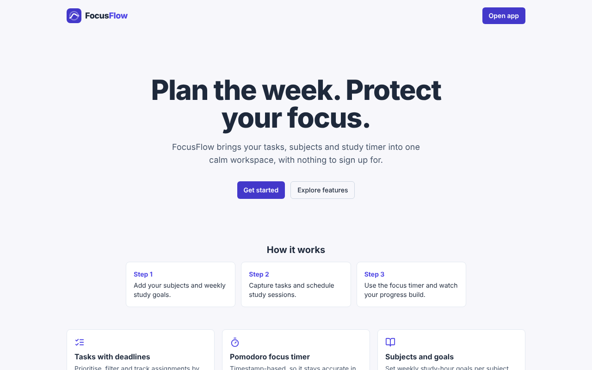
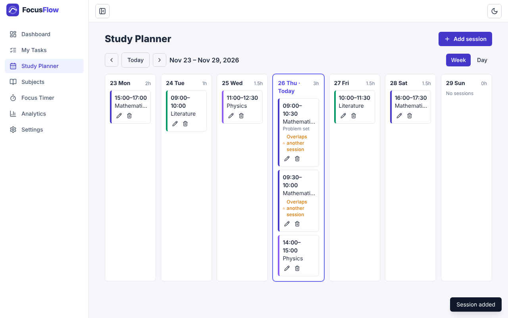
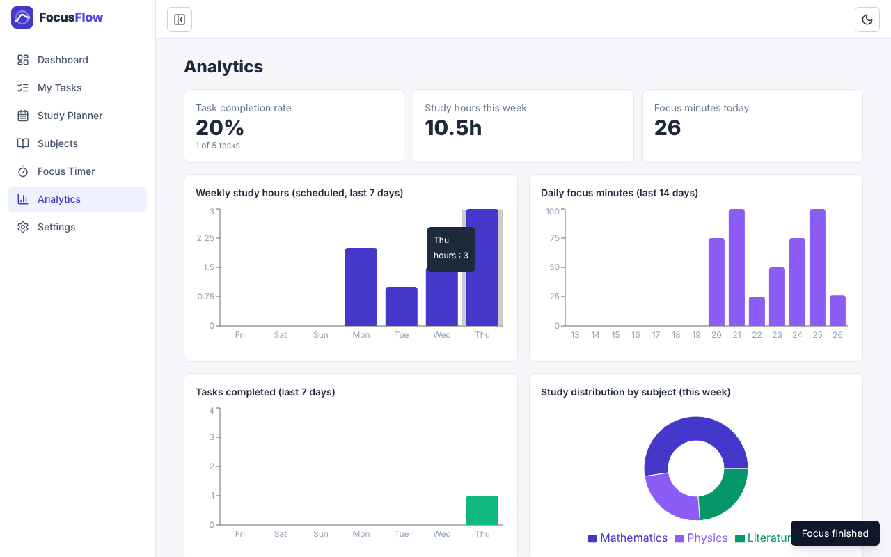
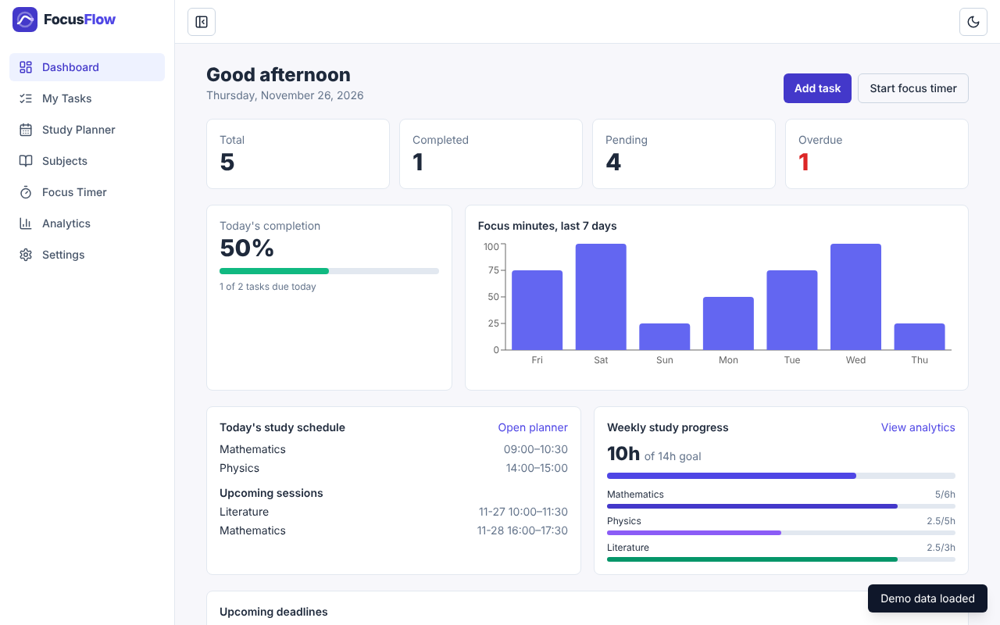

# FocusFlow

**A private, browser-based study planner that combines tasks, subjects, a weekly schedule, a Pomodoro timer and analytics in one workspace. No account, no backend: your data stays in your browser.**



## Features
- **Dashboard:** task statistics, today's completion, today's and upcoming study sessions, weekly goal progress per subject, 7-day focus chart, and a guided first-run empty state
- **My Tasks:** subjects, priorities, due dates, search, filters, sorting, overdue highlighting, completion progress
- **Study Planner:** week and day views, add/edit/delete sessions, daily scheduled hours, overlap warnings, today highlighted
- **Subjects:** colours, descriptions, weekly hour goals, per-subject task completion and weekly hours, safe deletion (keep or delete linked tasks and sessions)
- **Focus Timer:** focus, short break and long break modes; timestamp-based so it stays accurate in background tabs and survives a refresh; focus history
- **Analytics:** study hours, daily focus minutes, tasks completed, subject distribution, 4-week trend, completion rate, goal progress
- **Settings:** light/dark theme, validated timer durations (whole minutes, 1 to 120, long break not shorter than short break), JSON export/import, demo data, clear all data

| Study Planner | Analytics |
|---|---|
|  |  |



More: `docs/screenshots/analytics-dark.png` (dark mode), `docs/screenshots/dashboard-mobile.png` (390px wide).
Screenshots were captured from the production build using demo data.

## Tech stack
React 18, Vite 5, Tailwind CSS 3, React Router 6 (hash routing), Lucide React, Recharts. Pages are lazy-loaded; the main bundle is about 185 kB (about 60 kB gzipped). Dev tooling: Vitest, jsdom, Testing Library.

## Installation and development
Requires Node.js 18 or newer.
```bash
npm install
npm run dev        # http://localhost:5173
```

## Testing
```bash
npm test           # 41 automated tests (Vitest + jsdom)
```
The tests render the full app and drive it through its UI: tasks, subjects, planner (overlap detection, daily totals), timer, analytics, settings validation, import/export, persistence, navigation and first-run guidance. They run in jsdom, not a real browser.

## Production build
```bash
npm run build      # outputs dist/
npm run preview    # serve the build at http://localhost:4173
```

## Deployment
FocusFlow is a static site. It uses hash routing and relative asset paths (`base: './'`), so it works on any static host and under a sub-path without server rewrites.

**Vercel**
1. Push the project to GitHub.
2. In Vercel choose *Add New → Project* and import the repository.
3. Framework preset: **Vite**. Build command: `npm run build`. Output directory: `dist`.
4. Click *Deploy*.

**GitHub Pages (included workflow)**
1. Push to a GitHub repository whose default branch is `main`.
2. In the repository go to *Settings → Pages* and set *Source* to **GitHub Actions**.
3. Push to `main`. `.github/workflows/deploy.yml` runs the tests, builds, and publishes `dist/`. The site appears at `https://<user>.github.io/<repo>/`.

**Any static host (Netlify, Cloudflare Pages, S3)**: run `npm run build` and upload the contents of `dist/`.

## Project structure
```
src/
  components/  Logo, Modal, StudyOverview
  context/     Store.jsx: all state and localStorage persistence
  layouts/     AppLayout: sidebar, top bar, toasts
  pages/       Landing, Dashboard, Tasks, Planner, Subjects, Timer, Analytics, Settings
  utils/       stats.js: date, time and aggregation helpers
  test/        Vitest suites
docs/screenshots/
```

## How persistence works
Tasks, subjects, sessions, focus history and settings are stored in one localStorage key (`focusflow:v1`); the running timer uses `focusflow:timer`. Data never leaves your browser and is not synced across devices or browsers. Corrupt or invalid stored data falls back to defaults, and invalid timer durations are repaired. Use *Settings → Export JSON* to back up and *Import JSON* to restore.

## Manual browser testing checklist
Run `npm run dev` and open it in Chrome. Repeat at desktop width and in DevTools device mode (about 390 px wide), with the Console open.
- [ ] Landing: Get started opens the dashboard; Explore features scrolls to the features
- [ ] Dashboard (first run): the three-step guide shows; Load demo data fills every section
- [ ] Tasks: add (try empty title), edit, complete, delete, search, filters, sorting; overdue tasks show in red
- [ ] Subjects: add, edit, delete keeping tasks, delete removing tasks and sessions
- [ ] Planner: add sessions; an overlapping one shows a warning; daily hours are right; Next/Previous, Today and Day view work
- [ ] Timer: start, pause, resume, reset; refresh while running and confirm it resumes; set focus to 1 minute and confirm a session is logged
- [ ] Settings: clear a duration field (it stays empty while editing); enter 0 or text (message shown, old value kept); export, then import the file; clear all data
- [ ] Analytics: charts match your data and update after changes
- [ ] Dark mode on every page; the choice survives a refresh
- [ ] Mobile: menu drawer opens and closes; no horizontal scrolling on any page
- [ ] Console shows no errors

## Known limitations
- Data lives in one browser on one device; clearing site data deletes it. Export regularly.
- "Study hours" count scheduled sessions, not time actually studied.
- Tasks completed before completion dates were recorded are missing from the completion chart.
- Overlapping sessions are warned about, not blocked.
- Delete confirmations use the browser's native dialogs.
- The interface font is loaded from Google Fonts; offline it falls back to the system font.
- Browser testing was done in Chromium only. Firefox and Safari are untested.
- The GitHub Pages workflow has not been run on GitHub.

## Suggested repository details
Name: `focusflow-study-planner`. Description: *A private, browser-based student planner with tasks, a weekly study schedule, Pomodoro timer and analytics, built with React, Vite and Tailwind CSS.*

## Build Android and Windows apps with GitHub Actions (no Android Studio required)

This repository includes GitHub Actions workflows that build app packages in GitHub's cloud runners. You do not need Android Studio or a Windows computer to request these builds.

### Upload this project to GitHub

1. Create a new repository on GitHub.
2. Extract this ZIP and upload the **contents of the `focusflow` folder** to the repository (so `package.json`, `src/`, and `.github/` are at the repository root).
3. Commit the files to the `main` branch.

### Download an Android APK

1. Open the repository on GitHub and select **Actions**.
2. Choose **Build Android APK** and click **Run workflow** (or push a change to `main`).
3. Open the completed workflow run.
4. Under **Artifacts**, download `FocusFlow-Android-debug-APK` and extract it to get `app-debug.apk`.
5. Transfer the APK to your Android phone and open it to install. Android may ask you to allow installs from the app you used to open the file.

This workflow creates a **debug APK**, not a signed Play Store release. The first run may take several minutes while GitHub prepares the Android build environment.

### Download a Windows installer

1. In **Actions**, choose **Build Windows installer** and click **Run workflow** (or push a change to `main`).
2. Open the completed workflow run and download the `FocusFlow-Windows-installer` artifact.
3. Extract and run the `.exe` installer on Windows.

### Workflow limitations

- These workflows have been added to the source archive but have **not been run on GitHub** from this environment. Their success is not yet verified.
- APK is a debug build. A signed release build and Play Store publishing are not configured.
- GitHub Actions artifacts are temporary build downloads and are subject to GitHub's artifact retention settings.
- The app continues to store data locally; these wrappers do not add cloud sync, backend services, or authentication.

